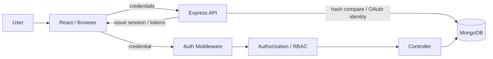
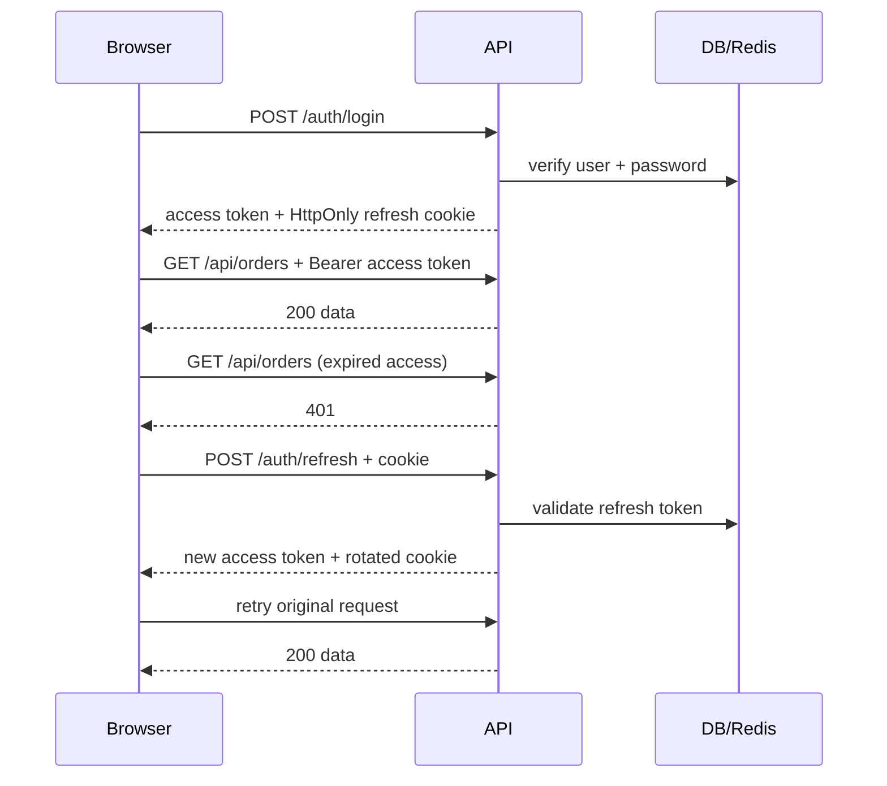
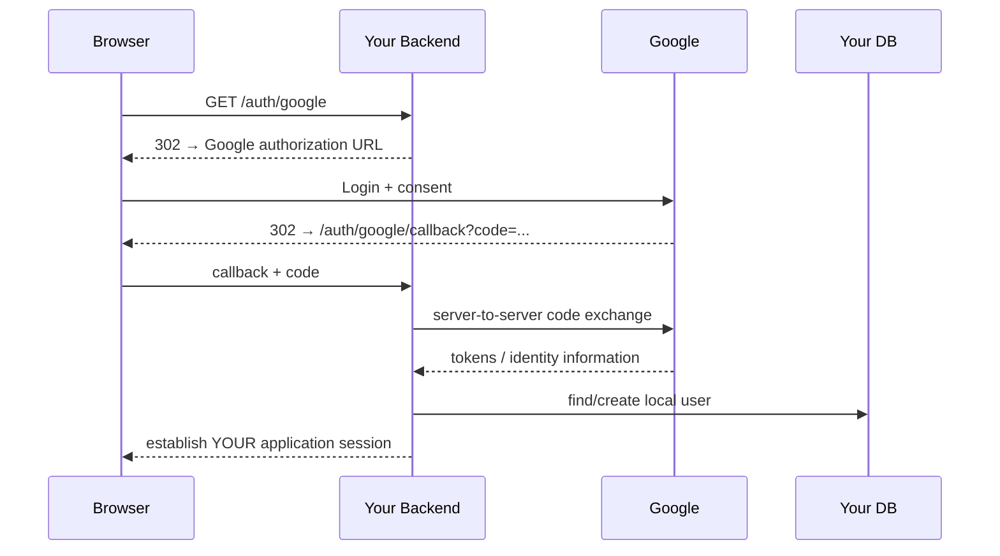

# 🔐 Authentication

> **Beginner → Advanced → Interview Ready**
---

## 🧭 What this repository is for

Authentication is not one feature called `login`.

A production application usually has a chain:

```text
Input validation
      ↓
Identity proof
      ↓
Session / token creation
      ↓
Request authentication
      ↓
Authorization
      ↓
Sensitive-action protection
      ↓
Session lifecycle + revocation
      ↓
Security monitoring
```

The goal of these notes is to let you explain that chain in an interview **without memorising random code**.

The core mental model is:

> **Authentication = Who are you?**  
> **Authorization = What are you allowed to do?**  
> **Session = How does the server remember that proof on later requests?**

Your supplied notes start from the same problem: HTTP is stateless, so the next request arrives looking like a stranger unless the request carries proof. fileciteturn2file9L840-L864

---

## 📚 Documentation map

| Document | What you learn |
|---|---|
| [`01-foundations.md`](./authentication-engineering-notes/docs/01-foundations.md) | Authentication, authorization, validation, 401 vs 403, trust boundaries |
| [`02-password-auth.md`](./authentication-engineering-notes/docs/02-password-auth.md) | Register/login, bcrypt, MongoDB, credential security |
| [`03-jwt-and-rbac.md`](./authentication-engineering-notes/docs/03-jwt-and-rbac.md) | JWT internals, signing, verification, RBAC, route guards |
| [`04-access-refresh.md`](./authentication-engineering-notes/docs/04-access-refresh.md) | Why access + refresh tokens exist, storage, rotation, reuse detection |
| [`05-google-oauth.md`](./authentication-engineering-notes/docs/05-google-oauth.md) | OAuth 2.0, OpenID Connect, Google setup, Passport, callback flow |
| [`06-browser-storage.md`](./authentication-engineering-notes/docs/06-browser-storage.md) | localStorage, cookies, memory, HttpOnly, Secure, SameSite, Path |
| [`07-security-attacks.md`](./authentication-engineering-notes/docs/07-security-attacks.md) | XSS, CSRF, session fixation, token theft, CSP, logging leaks |
| [`08-production-auth.md`](./authentication-engineering-notes/docs/08-production-auth.md) | sessions, multi-device login, logout, revocation, scaling, observability |
| [`09-engineering-setup.md`](./authentication-engineering-notes/docs/09-engineering-setup.md) | MERN implementation blueprint and package choices |
| [`10-interview-playbook.md`](./authentication-engineering-notes/docs/10-interview-playbook.md) | Expected questions, traps, debugging questions, strong answers |
| [`11-visual-flows.md`](./authentication-engineering-notes/docs/11-visual-flows.md) | Mermaid diagrams + request/response flows |
| [`12-cheatsheet.md`](./authentication-engineering-notes/docs/12-cheatsheet.md) | Final revision sheet before interview |

---

# 1. Start with the problem

Imagine three users send:

```http
POST /api/orders
Content-Type: application/json

{"productId":"123","quantity":2}
```

The server receives **HTTP requests, not humans**.

It cannot safely infer:

```text
"This request must be from Ritesh."
```

And sending `userId` in the body is not identity proof because the client controls the body:

```json
{"userId":"someone-else"}
```

The server therefore needs a credential that it can validate.

---

# 2. Authentication vs Authorization

```text
                    REQUEST
                       │
                       ▼
                 ┌────────────┐
                 │ Validation │  Is the input usable?
                 └─────┬──────┘
                       │
                       ▼
              ┌────────────────┐
              │ Authentication │  Who are you?
              └───────┬────────┘
                      │
                      ▼
              ┌────────────────┐
              │ Authorization  │  Are you allowed?
              └───────┬────────┘
                      │
                      ▼
                 ┌──────────┐
                 │Controller│
                 └──────────┘
```

| Concept | Question | Typical failure |
|---|---|---|
| Validation | Is this data valid? | `400 Bad Request` |
| Authentication | Who is this? | `401 Unauthorized` |
| Authorization | Can this identity perform this action? | `403 Forbidden` |

Your source notes explicitly use this validation → authentication → authorization → controller order. fileciteturn2file9L902-L924

**Interview trap:** `401` does not mean “you are not allowed.” It means the server does not have a valid authenticated identity. `403` means the identity is known but the action is forbidden. fileciteturn2file9L868-L900

---

# 3. How many authentication mechanisms can a website use?

A website can combine several mechanisms. They solve different problems.

| Mechanism | Example | Main purpose |
|---|---|---|
| Password authentication | Email + password | Traditional account login |
| Session-cookie auth | Session ID cookie | Server-managed login state |
| JWT bearer auth | `Authorization: Bearer ...` | Stateless API authentication |
| Access + refresh tokens | 10-min access + 7-day refresh | Short-lived API credentials + persistent login |
| Google / GitHub login | OAuth 2.0 + OIDC | Delegated identity/login |
| Magic link | Email login link | Passwordless login |
| OTP | Email/SMS/TOTP | Verification / MFA / recovery |
| WebAuthn / passkeys | Fingerprint/security key | Phishing-resistant authentication |
| SSO / SAML | Enterprise identity provider | Company-wide login |
| API keys | Server-to-server API | Application identification, not normal user login |
| mTLS | Client certificate | High-assurance machine/client identity |
| HTTP Basic | `Authorization: Basic ...` | Simple/internal/legacy use; only over TLS |

### Important distinction

**MFA is not simply another token-storage strategy.** It is a way to combine factors:

```text
Something you know  → password
Something you have  → phone/security key
Something you are   → biometric
```

A strong modern web application might use:

```text
Password OR Google OIDC
        ↓
Application session
        ↓
MFA / WebAuthn for sensitive actions
```

---

# 4. The ID-card mental model

Think of registration as admission and a token/session as an ID card.

```text
REGISTER
  ↓
Server verifies data
  ↓
User record created
  ↓
Server issues credential
  ↓
CLIENT STORES / SENDS CREDENTIAL
  ↓
Every protected request presents proof
  ↓
Server verifies proof
  ↓
req.user = authenticated identity
  ↓
Authorization checks permissions
```

The analogy from your notes maps JWT pieces to a college ID: user ID ≈ roll number, signature ≈ hologram, expiry ≈ card validity. fileciteturn2file6L616-L659

The important engineering idea is **not the analogy**. It is this:

> Password verification is expensive and should happen at login; later requests use a reusable proof with a controlled lifetime.

---

# 5. The big architecture



For a production access/refresh design:



---

# 6. Why tokens exist

HTTP is stateless. If you authenticate only once, the server needs a way to recognise later requests.

Bad design:

```text
Request 1 → send password
Request 2 → send password
Request 3 → send password
...
```

Better:

```text
LOGIN
  password → server
  server → credential

LATER
  credential → server
```

The credential is a **bearer credential**: possession is what the server relies on. Your source notes call this the root security problem: “whoever holds the token is the user” from the server's perspective. fileciteturn0file1L19-L27

That leads to the central security question:

> **Where can the credential live, and who can access it?**

---

# 7. JWT in one minute

A JWT normally looks like:

```text
HEADER.PAYLOAD.SIGNATURE
```

Example conceptual payload:

```json
{
  "sub": "user_123",
  "role": "buyer",
  "iat": 1760000000,
  "exp": 1760000900
}
```

A JWT is **not automatically encrypted**. JWT claims can be encoded as a JWS for integrity or as JWE when encryption is used. RFC 7519 defines JWT as a compact claims representation format. citeturn1search0

So:

```text
Readable?       Usually yes.
Tamper-proof?   Yes, if properly signed + verified.
Secret?         No.
Encrypted?      Not by ordinary signed JWT.
```

Your notes correctly emphasise that Base64URL is encoding, not encryption, and that changing the payload causes signature verification to fail. fileciteturn2file6L638-L659

---

# 8. The central security story: one token → two bad homes

A long-lived token has a storage dilemma.

### localStorage

```text
JavaScript can read it
        ↓
XSS can steal it
```

### Cookie

```text
Browser automatically sends it
        ↓
CSRF can cause authenticated actions
```

Your access/refresh notes frame the same dilemma and use it as the reason for splitting the credential into two parts. fileciteturn1file2L173-L195

---

# 9. Why access + refresh tokens appeared

The design goal is not “two tokens because modern apps do it.”

The design goal is:

```text
Short-lived credential
        +
Long-lived credential with stronger storage
        +
Rotation / revocation
        ↓
Smaller blast radius
```

Typical conceptual model:

| Token | Job | Typical lifetime | Browser home |
|---|---|---:|---|
| Access token | Authenticate API calls | ~5–15 min | Memory |
| Refresh token | Obtain a new access token | days/weeks | HttpOnly cookie |

Your supplied notes use this exact split. fileciteturn1file2L175-L195

The IETF's OAuth 2.0 Security BCP also explains why refresh tokens are useful: they allow short-lived access tokens with reduced scope, limiting the impact of access-token leakage; it recommends refresh-token rotation or sender-constrained refresh tokens for replay detection in public-client scenarios. citeturn1search1

---

# 10. The design in one picture

```text
                    LOGIN
                      │
            ┌─────────┴─────────┐
            ▼                   ▼
     ACCESS TOKEN          REFRESH TOKEN
     short-lived           long-lived
     in memory             HttpOnly cookie
            │                   │
            │                   │
     Authorization         browser sends
       header manually     only to refresh
            │                   │
            ▼                   ▼
       NORMAL API          /auth/refresh
            │                   │
            ▼                   ▼
           401 ───────────→ rotate
                              │
                              ▼
                       new access token
```

The asymmetry matters: the frontend code handles the access token, while the browser handles the HttpOnly refresh cookie. fileciteturn1file2L197-L216

---

# 11. Why not just use a 7-day access token?

Because theft becomes a 7-day problem.

Suppose:

```text
Access token lifetime = 7 days
Attacker steals it at 10:00 AM
```

If nothing else checks it, the attacker can replay it until expiry.

With:

```text
Access token = 10 minutes
Refresh token = protected + rotated
```

A stolen access token has a much smaller default lifetime.

This is **risk reduction**, not magic prevention.

---

# 12. Browser storage decision

| Storage | JS can read? | Auto sent? | Main risk |
|---|---:|---:|---|
| localStorage | Yes | No | XSS token theft |
| sessionStorage | Yes | No | XSS; tab/session lifetime only |
| normal cookie | No direct API? `document.cookie` can read non-HttpOnly | Yes | CSRF + XSS depending on flags |
| HttpOnly cookie | No | Yes | CSRF must be addressed |
| memory variable | Yes by same-origin JS | No | Live-page XSS can use it |

MDN documents that `HttpOnly` blocks JavaScript access but does **not** prevent the browser from sending the cookie on requests. `SameSite` controls cross-site sending and `Secure` restricts transmission to HTTPS. citeturn0search0turn0search3

### Recommended browser pattern for a typical SPA/API

```text
accessToken → memory
refreshToken → HttpOnly + Secure + SameSite cookie
```

But architecture depends on deployment topology, cross-site requirements, threat model, and whether you can use a server-side session.

---

# 13. XSS vs CSRF — the interview explanation

## XSS

Attacker gets JavaScript to execute **on your origin**.

```text
attacker-controlled script
        ↓
executes as your origin
        ↓
gets same JS privileges as your app
        ↓
can read localStorage / memory-accessible data
        ↓
can call your APIs as the user
```

OWASP describes XSS as attacker-controlled content executing in the application's context and recommends contextual output encoding, safe sinks, sanitization where needed, and defense-in-depth controls such as CSP. citeturn0search1

## CSRF

Attacker does **not** need to read the credential.

```text
Victim logged into bank.com
        ↓
Victim visits attacker.com
        ↓
attacker causes request to bank.com
        ↓
Browser automatically attaches bank cookie
        ↓
bank sees authenticated request
```

OWASP defines CSRF as tricking an authenticated browser into performing an unwanted action and recommends CSRF tokens for cookie-authenticated state-changing requests where appropriate. citeturn0search7

### Memorise this

> **XSS steals/uses the credential. CSRF abuses automatic credential attachment.**

Your source notes phrase it as: XSS steals the key; CSRF makes the browser open the door while the key stays with the victim. fileciteturn0file1L112-L165

---

# 14. Why HttpOnly does NOT “solve XSS”

This is a high-level interview trap.

`HttpOnly` means:

```text
JavaScript cannot directly read refreshToken
```

It does **not** mean:

```text
JavaScript cannot make authenticated requests
```

If malicious JavaScript is already executing inside your origin, it may be able to call your refresh endpoint and operate through the victim's live session.

Your notes explicitly call this loophole out: HttpOnly changes the persistence/blast radius of stolen credentials; it does not make a compromised page harmless. fileciteturn1file3L247-L256

Therefore:

```text
Prevent XSS first
  → safe rendering
  → sanitization where needed
  → CSP
  → dependency hygiene
  → avoid unnecessary third-party scripts

Then limit XSS impact
  → short access TTL
  → refresh rotation
  → absolute session lifetime
  → step-up WebAuthn
```

---

# 15. Refresh-token rotation

Without rotation:

```text
RT-1 valid for 30 days
RT-1 stolen
RT-1 attacker can replay for 30 days
```

With rotation:

```text
Login
  ↓
RT-1 active
  ↓ refresh
RT-1 consumed → RT-2 active
  ↓ refresh
RT-2 consumed → RT-3 active
```

If someone reuses `RT-2` after it has already been consumed:

```text
RT-2 presented again
       ↓
usedAt already exists
       ↓
possible replay / theft
       ↓
revoke token family
       ↓
force re-authentication
```

Your notes call refresh tokens single-use and group them into a token family. fileciteturn1file3L260-L281

RFC 9700 independently recommends rotation as a replay-detection mechanism and explains that when a compromised refresh token is used by both attacker and legitimate client, the server can detect the invalidated-token reuse and revoke the active token. citeturn1search1

### Important nuance

Rotation is **detection**, not perfect prevention.

The attacker and legitimate client can race. The server may not know which party is genuine, so fail-closed behavior can terminate the session family. Your supplied notes make this exact point. fileciteturn1file1L109-L120

---

# 16. Refresh race condition

Suppose the dashboard loads and fires 8 requests.

```text
8 requests → 8 × 401
           ↓
8 refresh calls
           ↓
rotation
           ↓
first refresh consumes RT-1
           ↓
others replay RT-1
           ↓
false reuse detection
```

Correct client behavior:

```text
401
 ↓
create ONE in-flight refresh promise
 ↓
all failed requests await it
 ↓
refresh once
 ↓
store new access token
 ↓
retry requests
```

Your notes use an Axios `refreshing` promise to serialize refresh work. fileciteturn1file4L315-L334

---

# 17. Cookie flags you should know

```js
res.cookie("refreshToken", token, {
  httpOnly: true,
  secure: process.env.NODE_ENV === "production",
  sameSite: "strict",
  path: "/api/auth/refresh",
  maxAge: 7 * 24 * 60 * 60 * 1000
});
```

| Flag | Meaning | Why |
|---|---|---|
| `HttpOnly` | JS cannot read cookie | Limits token theft through `document.cookie` |
| `Secure` | HTTPS only | Protects in transit |
| `SameSite=Strict` | Restricts cross-site cookie sending | Strong CSRF defense |
| `SameSite=Lax` | More permissive | Often useful for normal web navigation |
| `SameSite=None` | Cross-site sending allowed | Requires `Secure`; needs stronger CSRF design |
| `Path` | Limits request paths receiving cookie | Reduces exposure surface |
| `Max-Age` | Lifetime | Limits persistence |

MDN documents the behavior of these attributes and notes that `SameSite=None` requires `Secure`. citeturn0search0turn0search4

**Nuance:** cookie `Path` controls when the browser sends the cookie; it is not a general authorization boundary. MDN explicitly warns not to treat it as a protection against unauthorized reading from another path. citeturn0search0

---

# 18. JWT role tampering

Attacker sees:

```json
{"sub":"123","role":"buyer"}
```

They can decode it and create:

```json
{"sub":"123","role":"admin"}
```

But they cannot create a valid signature without the signing key.

```text
original header + original payload
          ↓
       server secret
          ↓
      signature A

attacker changes payload
          ↓
header + changed payload
          ↓
server recomputes signature
          ↓
signature B ≠ signature A
          ↓
reject
```

So the correct interview answer is:

> **The payload is readable, but the server trusts only a successfully verified signature.**

Use `jwt.verify()`, not `jwt.decode()`, for authentication. Your notes explicitly warn that `decode()` only reads the payload and does not establish trust. fileciteturn2file3L353-L379

---

# 19. RBAC — Role-Based Access Control

Authentication:

```text
Who are you?
→ req.user = { id, role }
```

Authorization:

```text
Can your role perform this action?
```

Example:

```js
router.delete(
  "/products/:id",
  isLoggedIn,
  allow("admin"),
  deleteProduct
);
```

The middleware chain is:

```text
request
  ↓
isLoggedIn
  ↓ 401 if invalid
req.user
  ↓
allow("admin")
  ↓ 403 if wrong role
controller
```

Your source notes use exactly this authentication → authorization → controller pattern. fileciteturn2file3L380-L403

### Frontend guard ≠ security boundary

React can hide:

```text
/admin
```

from a buyer.

But that is UX, not security.

A user can call:

```http
DELETE /api/products/123
```

directly from Postman.

Therefore:

```text
Frontend guard → user experience
Backend authorization → actual security
```

---

# 20. Role inside JWT vs DB lookup

### JWT role

```text
request
 ↓
verify JWT
 ↓
role already available
 ↓
no DB lookup for role
```

Fast and scalable, but stale until token expiry or additional revocation checks.

### DB role lookup

```text
request
 ↓
verify identity
 ↓
DB lookup
 ↓
current role
```

Fresh role state, but adds database/Redis work to the hot path.

### Engineering trade-off

A practical design often uses:

```text
short-lived access token
+
important authorization checks server-side
+ 
revocation/version/watermark when immediate invalidation matters
```

Your source notes describe a `validAfter:userId` Redis watermark as an O(1)-style revocation mechanism rather than maintaining a huge individual JWT blocklist. fileciteturn1file4L335-L346

---

# 21. Password authentication

Registration flow:

```text
POST /register
    ↓
validate
    ↓
check duplicate email
    ↓
bcrypt/Argon2 hash
    ↓
store hash
    ↓
issue session/token
```

Login flow:

```text
POST /login
    ↓
validate
    ↓
find user
    ↓
compare password against hash
    ↓
issue credential
```

Never store:

```json
{"password":"MyPassword123"}
```

Store a password hash.

Your notes explain that hashing is one-way, while encryption is designed to be reversible with a key. They also explain why fast hashes such as MD5/SHA-256 are not appropriate password hashing choices and why a password-hashing algorithm uses a salt. fileciteturn0file2L293-L342

For new systems, evaluate modern password hashing such as **Argon2id**; bcrypt remains common in Node/MERN projects and is useful to understand for interviews.

---

# 22. Why salt?

Without unique salts:

```text
password = "hello123"
password = "hello123"
        ↓
possibly same hash
```

With a random salt:

```text
hello123 + randomSaltA → hashA
hello123 + randomSaltB → hashB
```

Same password → different stored hashes.

A salt is not a secret key. It can be stored with the password hash.

Your notes explain that bcrypt stores the salt information inside the bcrypt hash representation so `compare()` can reuse it during verification. fileciteturn0file2L349-L392

---

# 23. Google login: OAuth 2.0 vs OpenID Connect

This distinction is extremely important.

### OAuth 2.0

Primarily about **delegated authorization**:

> “Can this application access this resource on behalf of the user?”

### OpenID Connect (OIDC)

Authentication/identity layer built on OAuth 2.0:

> “Who is the user?”

So when you build **Sign in with Google**, you should think in terms of **OIDC**, even though the underlying flow uses OAuth 2.0 mechanisms.

Your original Google notes explicitly distinguish OAuth 2.0 authorization from OIDC authentication. fileciteturn2file4L484-L493

---

# 24. Google authorization-code flow



Google's current documentation recommends server-side authorization for web applications that need server-side access and describes the authorization-code exchange. citeturn2search0turn2search1

### Why the authorization code?

The browser receives a short-lived code, not your application's final session credential.

```text
browser → code → backend
backend → token exchange → Google
```

This keeps the sensitive token exchange on the server side in a confidential web-app flow.

---

# 25. Google setup

Your original notes use Passport.js with:

```bash
npm install express passport passport-google-oauth20 dotenv morgan
```

and, if using Passport sessions:

```bash
npm install express-session
```

Your notes explain the role of each package and the `GoogleStrategy`, `scope`, `passport.initialize()`, and `session: false` concepts. fileciteturn2file8L741-L777

### Current Google setup checklist

1. Create/configure a project in Google Cloud.
2. Configure the OAuth consent screen.
3. Create an OAuth client for your web application.
4. Configure authorized redirect URIs.
5. Keep client secrets server-side.
6. Request the minimum scopes required.
7. Use HTTPS in production.
8. Use a correct `state`/CSRF strategy for redirect-based OAuth.

Google's current production guidance emphasises HTTPS redirect URIs, owned domains, least-privilege scopes, and production verification requirements for sensitive/restricted scopes. citeturn2search4

### Important update to the old notes

The old note says “enable Google+ API.” Do **not** blindly copy that step into a modern project. Google APIs and identity configuration have evolved; follow the current Google Identity/OAuth documentation for the APIs/scopes your application actually needs.

---

# 26. Passport GoogleStrategy

Conceptually:

```js
passport.use(
  new GoogleStrategy(
    {
      clientID: process.env.GOOGLE_CLIENT_ID,
      clientSecret: process.env.GOOGLE_CLIENT_SECRET,
      callbackURL: "/auth/google/callback"
    },
    async (accessToken, refreshToken, profile, done) => {
      // find/create your local user
      // then call done(null, user)
    }
  )
);
```

Then:

```js
app.use(passport.initialize());

app.get(
  "/auth/google",
  passport.authenticate("google", {
    scope: ["profile", "email"]
  })
);

app.get(
  "/auth/google/callback",
  passport.authenticate("google", {
    session: false,
    failureRedirect: "/login"
  }),
  (req, res) => {
    // req.user is available here
  }
);
```

Your source notes explain the two-middleware callback pattern: Passport authenticates first; the next handler runs only after successful authentication. fileciteturn2file0L69-L78

---

# 27. Client ID vs Client Secret

```text
client_id     → identifies your application
client_secret → authenticates the confidential client to provider
```

Never put the Google client secret into React/Vite frontend code.

Google's documentation explicitly says client secrets should remain confidential and should not be included in the app. citeturn2search2

---

# 28. OAuth scopes

A scope answers:

> “What access is this application asking Google to grant?”

Examples conceptually:

```text
openid
email
profile
calendar.readonly
```

Ask for the minimum permissions needed.

This is **least privilege**.

Google's production guidance explicitly recommends requesting only the scopes required for the feature. citeturn2search4

---

# 29. Sessions vs JWTs

Do not make this mistake in an interview:

> “JWT = authentication and session = old technology.”

Both are valid session-management strategies.

### Stateful session

```text
browser → session ID cookie
server → session store
```

```text
Cookie: sid=abc123
             ↓
Redis / DB
             ↓
userId = 123
role = admin
```

Benefits:

- Easy revocation
- Server controls current session state
- Simple “logout everywhere”

Costs:

- Session store
- Network lookup / shared state across servers
- More operational state

### Stateless JWT

```text
browser → signed JWT
server → verify signature locally
```

Benefits:

- No central session lookup for every request
- Easy horizontal scaling
- Useful for APIs/multiple services

Costs:

- Revocation is harder
- Claims can become stale
- Token theft is dangerous
- You still need careful key management and expiry

---

# 30. Multi-device authentication

A serious application can model each login as a separate session.

```text
USER 101
 ├── Session A → iPhone / Safari / Mumbai
 ├── Session B → MacBook / Chrome / Delhi
 └── Session C → Android / Chrome / Bangalore
```

This matches the architecture shown in your supplied advanced-authentication image: each successful login creates a session record, with device/browser/location/IP metadata, and the system can notify other devices. The same image also shows logout-this-device vs keeping other sessions active. fileciteturn2file0L82-L104

### Production session fields

```text
sessionId
userId
refreshTokenHash
familyId
deviceName
browser
os
ipAddress
country/city (carefully)
createdAt
lastActiveAt
expiresAt
revokedAt
```

Do not blindly store precise location just because it is technically available. Store only what the product/security requirement needs.

---

# 31. Logout semantics

### Logout this device

```text
browser
  ↓
POST /auth/logout
  ↓
revoke current refresh/session record
  ↓
clear cookie
  ↓
clear access token in memory
```

### Logout all devices

```text
user
  ↓
POST /auth/logout-all
  ↓
revoke every session family
  ↓
optional validAfter watermark
```

Important:

> Clearing a cookie only clears the browser that owns the cookie. It does not magically revoke a stateless JWT already copied by an attacker.

Your source notes call this out as a fundamental limitation of purely stateless auth. fileciteturn0file2L575-L607

---

# 32. Token theft: how a browser becomes dangerous

There are several distinct theft paths.

### 1. XSS

```text
attacker script executes on your origin
        ↓
reads JS-accessible credential
        ↓
sends credential/data to attacker
```

### 2. Logs

```text
Authorization: Bearer eyJ...
        ↓
access log / Sentry / console
        ↓
credential persists somewhere else
```

Your supplied notes specifically warn never to allow tokens into logs and to redact authorization headers at the logger level. fileciteturn1file4L347-L368

### 3. URLs

Bad:

```text
https://example.com/reset?token=...
```

Tokens in URLs can leak through browser history, referrers, proxies, analytics, and logs. Your notes explicitly advise keeping tokens out of URLs. fileciteturn1file9L718-L735

### 4. Malicious extension / infected device

Application-level controls cannot fully defend a compromised device or privileged browser extension.

### 5. Supply-chain compromise

A compromised dependency can execute as your application's JavaScript.

This is why authentication security is broader than JWT configuration.

---

# 33. CSP and Trusted Types

Authentication architecture should assume XSS prevention is foundational.

Defense layers:

```text
React escaping / safe rendering
        ↓
Avoid dangerous HTML sinks
        ↓
Sanitize genuinely HTML-bearing input
        ↓
CSP
        ↓
Trusted Types where appropriate
        ↓
Dependency / script hygiene
```

OWASP explicitly warns that CSP is defense-in-depth rather than a substitute for fixing XSS, and recommends output encoding/sanitization and safe sinks. citeturn0search1

---

# 34. WebAuthn / passkeys

Why can WebAuthn help when password re-entry cannot?

A compromised page can draw a fake password modal and capture the password.

WebAuthn uses a cryptographic credential bound to the relying party origin and a server-issued challenge. The private key is not handed to page JavaScript.

Use it for step-up actions such as:

```text
change password
change email
add payee
large payment
delete account
view sensitive data
```

Your supplied notes identify WebAuthn as the step-up mechanism that survives a compromised page better than password re-entry because the security interaction is handled outside ordinary page content and the assertion is origin-bound. fileciteturn1file8L685-L692

---

# 35. Advanced: bearer tokens vs proof-of-possession

A bearer token says:

```text
"If you have me, you can use me."
```

Proof-of-possession tries to say:

```text
"You need the token + proof that you own the corresponding key."
```

DPoP is one OAuth mechanism in this direction. RFC 9700 recommends considering sender-constrained access tokens, such as DPoP or mTLS, for stronger protection against misuse of stolen tokens. citeturn1search3

For a normal MERN internship project, do **not** jump directly to DPoP because it sounds advanced. First understand:

```text
HTTPS
→ password hashing
→ secure session/token storage
→ short access TTL
→ refresh rotation
→ CSRF/XSS defenses
→ revocation
→ monitoring
```

Then learn proof-of-possession.

---

# 36. The advanced-authentication image — how to read it

The provided diagram shows a larger system:

```text
User
 ↓
Frontend
 ↓
Backend/Auth Server
 ↓
Database
 ↓
Real-time notification service
 ↓
Other devices
```

It also models:

- New session creation
- Device/browser/IP/location metadata
- Access + refresh token generation
- Session table
- Real-time login notifications
- Logout this device
- Logout other devices
- Password hashing
- HTTPS
- short-lived access tokens
- rate limiting
- audit logs

Use the image as a **system-design visual**, not as proof that every application needs every component.


---

# 37. Where the Razorpay diagram fits

The supplied Razorpay diagram is primarily a **payment-flow** example, not an authentication flow.

It is still useful because it demonstrates an important engineering boundary:

```text
Frontend
   ↓
Backend creates order
   ↓
Third-party provider
   ↓
Provider result
   ↓
Backend verifies
   ↓
Database update
```

The same principle applies to authentication:

```text
Frontend starts login
   ↓
Backend/provider verifies identity
   ↓
Backend establishes YOUR application session
   ↓
Database/session store updated
```

Never trust the frontend saying “payment succeeded” or “user is admin.” The backend verifies the authoritative proof.


---

# 38. Production security baseline

For a serious MERN application:

```text
[ ] HTTPS everywhere
[ ] Strong password hashing
[ ] Server-side validation
[ ] Generic login errors
[ ] Short access-token TTL
[ ] Refresh-token rotation
[ ] Reuse detection
[ ] HttpOnly + Secure cookies where appropriate
[ ] SameSite / CSRF strategy
[ ] No tokens in logs
[ ] No tokens in URLs
[ ] CSP
[ ] Dependency hygiene
[ ] Rate-limit login + refresh
[ ] Session revocation
[ ] Password-change revocation
[ ] Audit sensitive actions
[ ] Security alerts for suspicious login/session events
[ ] WebAuthn/MFA for high-risk actions
```

Your notes rank a baseline around short access TTL, rotation/reuse detection, secure cookie attributes, CSP/HSTS, no token leakage, and revocation on password change; higher-assurance systems add session caps, WebAuthn, anomaly detection and proof-of-possession. fileciteturn1file8L668-L692

---

# 39. Scaling authentication

## Small app

```text
1 API server
1 MongoDB
JWT verification locally
```

## Medium app

```text
Load balancer
   ↓
API × N
   ↓
MongoDB
Redis for session/revocation/rate limits
```

## Large app

Consider:

```text
Identity service / authorization service
Key rotation + JWKS
Redis/session infrastructure
Multiple resource servers
Audit pipeline
Rate limiting
Anomaly detection
WebAuthn / MFA
Sender-constrained tokens for high-risk systems
```

### Bottlenecks

- Password hashing is intentionally CPU-expensive.
- DB lookup per request can become expensive.
- Refresh endpoints can be abused.
- Session store latency affects every authenticated request in stateful designs.
- Token verification itself is usually cheap relative to password hashing/database work, but at very high QPS you still measure CPU, algorithm choice, key operations and service architecture.

Never answer “JWT scales infinitely” in an interview. Statelessness removes one kind of shared state; it does not remove CPU, network, database, rate-limit or key-management costs.

---

# 40. Engineering request lifecycle

For every protected request, narrate:

```text
1. Browser creates request
2. Credential attached
3. TLS protects transport
4. Reverse proxy / server receives request
5. Validation runs
6. Auth middleware extracts credential
7. Signature/session is verified
8. Identity is attached to request context
9. Authorization middleware checks role/permission/ownership
10. Controller performs business operation
11. Database changes
12. Response returned
13. Logs/metrics record safe metadata
```

Express middleware is explicitly designed to operate in this request-response chain, modify `req`/`res`, end the cycle, or call `next()`. citeturn0search6

---

# 41. Ownership checks — beyond RBAC

RBAC alone can be insufficient.

Example:

```text
User A role = user
User B role = user
```

Both have the same role, but User A should not read User B's private order.

So authorization can be:

```text
Role check
   +
Resource ownership check
   +
Permission check
   +
Tenant check
```

Example:

```js
if (req.user.id !== order.userId && req.user.role !== "admin") {
  return res.status(403).json({ message: "Forbidden" });
}
```

This is why “RBAC” should not become your entire security vocabulary.

---

# 42. Common bugs and debugging method

## Bug: user randomly logged out

Check:

```text
access token expiry
refresh cookie present?
SameSite mismatch?
Secure flag on localhost?
CORS credentials?
refresh endpoint path?
refresh token revoked?
clock skew?
```

JWT time claims such as `exp`, `nbf`, and `iat` are based on NumericDate values, and implementations can allow limited clock-skew leeway. citeturn1search0

## Bug: redirect loop

Trace:

```text
route guard
 → auth bootstrap
 → /refresh
 → 401
 → state becomes unauthenticated
 → redirect login
 → route loads again
```

Fix the state machine rather than adding random `setTimeout()` calls.

## Bug: refresh reuse detected for legitimate user

Suspect:

```text
parallel refresh calls
lost refresh response + retry
multiple tabs
mobile network retry
```

Use a client-side single-flight refresh mechanism and consider a carefully designed short grace/idempotency window. Your source notes call out the network-loss false positive specifically. fileciteturn1file1L113-L120

---

# 43. What to log — and what NOT to log

### Safe-ish metadata

```text
requestId
userId (where appropriate)
route
status
latency
sessionId/family ID in a non-secret form
security event type
```

### Never log

```text
password
JWT
refresh token
Authorization header
session cookie value
OAuth client secret
OTP
reset token
```

Redaction should happen centrally at the logging boundary, not only at individual call sites. fileciteturn1file9L714-L735

---

# 44. Account enumeration

Bad:

```text
email not found
```

versus:

```text
wrong password
```

That lets attackers discover registered accounts.

Better:

```text
invalid email or password
```

Your source implementation notes explicitly recommend the same generic message. fileciteturn2file3L321-L349

---

# 45. A production-ready auth data model

### User

```text
User
 ├─ _id
 ├─ email
 ├─ passwordHash?
 ├─ role
 ├─ googleSubject?
 ├─ emailVerifiedAt
 ├─ createdAt
 └─ updatedAt
```

### Session

```text
Session
 ├─ _id
 ├─ userId
 ├─ familyId
 ├─ refreshTokenHash
 ├─ createdAt
 ├─ lastUsedAt
 ├─ expiresAt
 ├─ revokedAt
 ├─ device metadata
 └─ security metadata
```

### Optional security-event collection

```text
SecurityEvent
 ├─ type
 ├─ userId
 ├─ sessionId
 ├─ requestId
 ├─ timestamp
 ├─ risk metadata
 └─ result
```

---

# 46. Recommended repository structure

```text
authentication-engineering-notes/
│
├── README.md
│
├── assets/
│   ├── advanced-auth-flow.png
│   └── razorpay-payment-flow.png
│
└── docs/
    ├── 01-foundations.md
    ├── 02-password-auth.md
    ├── 03-jwt-and-rbac.md
    ├── 04-access-refresh.md
    ├── 05-google-oauth.md
    ├── 06-browser-storage.md
    ├── 07-security-attacks.md
    ├── 08-production-auth.md
    ├── 09-engineering-setup.md
    ├── 10-interview-playbook.md
    ├── 11-visual-flows.md
    └── 12-cheatsheet.md
```

This is intentionally **docs-first**. Do not mix implementation code into the knowledge repository unless you are building a companion demo.

---

# 47. Official references

- MDN — Cookies / `Set-Cookie`
- OWASP — XSS Prevention Cheat Sheet
- OWASP — CSRF Prevention Cheat Sheet
- IETF RFC 7519 — JSON Web Token
- IETF RFC 9700 — OAuth 2.0 Security Best Current Practice
- Google Developers — OAuth / server-side authorization
- Express — Middleware guide

See the detailed links in the individual documents.

---

# 🧠 Final mental model

When an interviewer asks **anything** about authentication, think in this order:

```text
1. WHAT is the identity proof?
        ↓
2. WHERE is it stored?
        ↓
3. HOW is it verified?
        ↓
4. HOW long is it valid?
        ↓
5. HOW can it be stolen?
        ↓
6. HOW does the attacker replay it?
        ↓
7. HOW do we revoke it?
        ↓
8. WHAT can the identity do?
        ↓
9. HOW does it scale?
        ↓
10. HOW do we detect/debug failures?
```

If you can walk through those ten questions, you are no longer memorising “JWT authentication.” You are reasoning about an authentication system.
