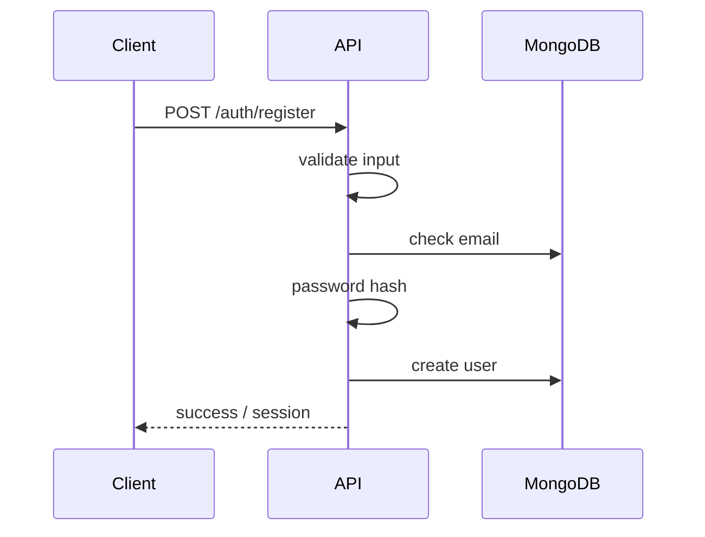
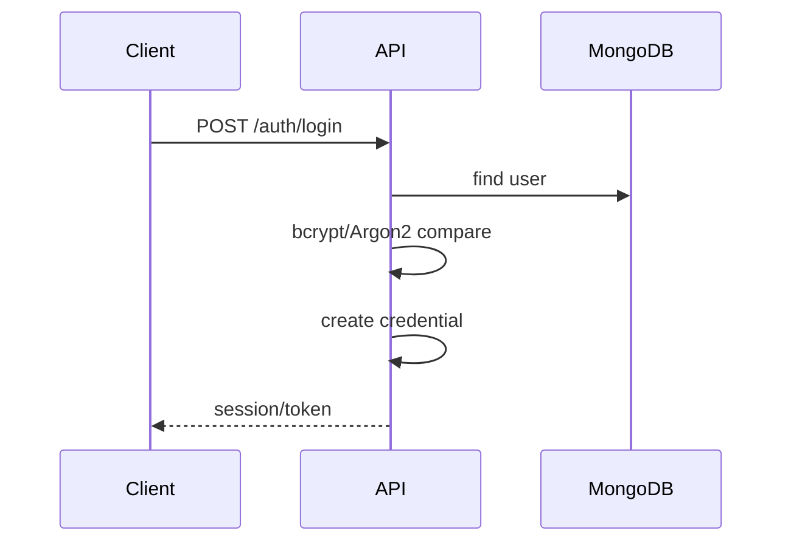

# 02 — Password Authentication

## 1. Registration



## 2. Login



## 3. Why hashing?

You do not need to recover a user's original password. You only need to answer:

```text
Does supplied password match the stored verifier?
```

Therefore store a password hash, not encrypted/plain password.

### Encoding vs encryption vs hashing

| Property | Encoding | Encryption | Password hashing |
|---|---|---|---|
| Reversible | Yes | Yes with key | No by design |
| Secret key required | No | Yes | No secret key required |
| Example | Base64 | AES | Argon2id / bcrypt |
| Purpose | Representation | Confidentiality | Password verification |

## 4. Salt

```text
password + random salt → password hash
```

Each password receives a unique salt.

This prevents identical passwords from producing identical stored hashes and defeats simple precomputed-table attacks.

## 5. bcrypt

Common Node/MERN implementation:

```js
const hash = await bcrypt.hash(password, 12);

const valid = await bcrypt.compare(password, user.passwordHash);
```

Do not think of `compare()` as decrypting the password. It recomputes the password hash using the salt/cost information represented by the stored bcrypt hash and compares the result.

### Interview nuance

Your older study notes use cost `10`. That is useful to understand, but production cost should be benchmarked on your infrastructure and kept current. Modern systems should also consider Argon2id.

## 6. User model

```js
const userSchema = new mongoose.Schema({
  email: {
    type: String,
    required: true,
    unique: true,
    lowercase: true
  },
  passwordHash: {
    type: String,
    required: true,
    select: false
  },
  role: {
    type: String,
    enum: ["user", "admin"],
    default: "user"
  }
});
```

`select: false` is defense-in-depth: normal queries do not fetch the password hash unless explicitly requested.

## 7. Registration controller shape

```js
async function register(req, res) {
  const { email, password } = req.body;

  // 1. validate
  // 2. normalize
  // 3. check uniqueness
  // 4. hash password
  // 5. create user
  // 6. establish session
}
```

Never log the password.

## 8. Login failure messages

Do not return:

```text
User does not exist
Wrong password
```

Prefer:

```text
Invalid email or password
```

Otherwise you create an account-enumeration oracle.

## 9. Password reset

Typical flow:

```text
User requests reset
   ↓
server creates random one-time reset token
   ↓
store only hash of reset token + expiry
   ↓
send link by email
   ↓
user submits token + new password
   ↓
server verifies hash + expiry + one-time use
   ↓
update password hash
   ↓
revoke existing sessions
```

Never put a reset token in logs.

## 10. Password change

A password change should normally trigger session invalidation/revocation because the user may be responding to suspected compromise.

## 11. Interview questions

### Why not SHA-256 for passwords?

SHA-256 is designed to be fast. Password hashing should be deliberately expensive and memory/CPU-hard to slow guessing attacks.

### Why not encrypt passwords?

Because the application does not need to recover the password. Encryption is reversible; password verification should not require plaintext recovery.

### What is a salt?

A unique random value combined with each password before hashing. It prevents identical passwords from sharing the same stored hash.

### Where should hashing happen?

On the server over a protected connection. Client-side hashing does not replace password hashing at the server and can become a replay credential if treated as the password.
