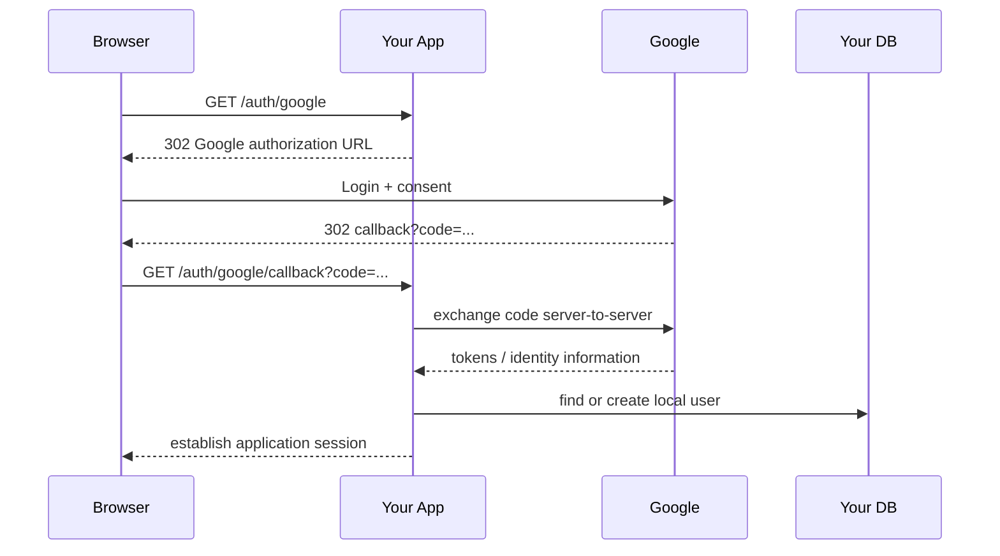

# 05 — Google OAuth 2.0 / OpenID Connect

## 1. What are OAuth and OIDC?

OAuth 2.0 is primarily an authorization framework.

OpenID Connect adds an identity layer on top of OAuth 2.0.

For “Sign in with Google”, the important mental model is:

```text
Google proves the user's Google identity
        ↓
Your backend maps that identity to a local user
        ↓
Your app establishes its own session
```

## 2. Actors

```text
Resource owner → user
Client         → your application
Authorization server → Google
Resource server      → Google API
```

## 3. Authorization Code Flow



The supplied notes describe this browser → callback → server token exchange → profile → local handler flow. fileciteturn2file1L138-L179

Google's current server-side docs also describe receiving a one-time authorization code and exchanging it server-side. citeturn2search1

## 4. Why authorization code?

A code is short-lived and exchanged at the token endpoint.

Conceptually:

```text
Browser receives code
        ↓
Backend receives code
        ↓
Backend proves client identity
        ↓
Google issues tokens
```

Modern OAuth security guidance strongly favors secure redirect-based flows and has deprecated weaker legacy patterns in several contexts. RFC 9700 is the current OAuth 2.0 Security Best Current Practice. citeturn1search1

## 5. Packages for a Passport implementation

Your supplied demo uses:

```bash
npm install express passport passport-google-oauth20 dotenv morgan
```

If using Passport's server-side session feature:

```bash
npm install express-session
```

Your notes describe these package roles and the `GoogleStrategy`. fileciteturn2file8L741-L777

## 6. Environment

```env
GOOGLE_CLIENT_ID=...
GOOGLE_CLIENT_SECRET=...
GOOGLE_CALLBACK_URL=http://localhost:3000/auth/google/callback
```

Never commit `.env`.

## 7. Google console setup

Conceptual setup:

```text
Google Cloud
  ↓
create/select project
  ↓
configure OAuth consent / identity settings
  ↓
create OAuth client
  ↓
choose web application
  ↓
register redirect URI
  ↓
copy client ID + secret
```

Your original notes use `http://localhost:3000/auth/google/callback` as the development callback. fileciteturn2file5L505-L545

For production, use HTTPS and correct registered redirect URIs. Google explicitly recommends secure redirect URIs and owned domains for production. citeturn2search4

## 8. Passport initialization

```js
app.use(passport.initialize());
```

This initializes Passport middleware for request processing.

## 9. Strategy

```js
passport.use(
  new GoogleStrategy(
    {
      clientID: process.env.GOOGLE_CLIENT_ID,
      clientSecret: process.env.GOOGLE_CLIENT_SECRET,
      callbackURL: process.env.GOOGLE_CALLBACK_URL
    },
    async (accessToken, refreshToken, profile, done) => {
      try {
        const googleId = profile.id;
        const email = profile.emails?.[0]?.value;

        // find/create local user
        const user = await findOrCreateUser({
          googleId,
          email,
          name: profile.displayName
        });

        done(null, user);
      } catch (err) {
        done(err);
      }
    }
  )
);
```

## 10. Start route

```js
app.get(
  "/auth/google",
  passport.authenticate("google", {
    scope: ["profile", "email"]
  })
);
```

A scope is the permission being requested.

## 11. Callback route

```js
app.get(
  "/auth/google/callback",
  passport.authenticate("google", {
    session: false,
    failureRedirect: "/login"
  }),
  (req, res) => {
    // req.user is available
  }
);
```

The supplied notes explain that Express runs Passport authentication first and reaches the final handler only after success. fileciteturn2file0L69-L78

## 12. `session: false`

If you do not want Passport to maintain its own login session:

```js
passport.authenticate("google", { session: false })
```

Then you can establish your own JWT/session model.

This does **not** mean “sessions are bad.” It means Passport itself is not maintaining the application session in that route.

## 13. Local user creation

Production flow:

```text
Google identity
   ↓
find googleSubject/provider ID
   ↓
existing user? → yes → sign in
   ↓ no
create local user
   ↓
establish local session
```

Do not use an email string as your only provider identity key without understanding provider verification/account-linking rules. A provider's stable subject/ID is normally the better external identity identifier.

## 14. Client ID vs secret

```text
client ID     → identifier
client secret → confidential credential
```

Client secret stays server-side. Google explicitly recommends protecting it. citeturn2search2

## 15. OAuth state / CSRF

Redirect-based authentication must protect the flow from login CSRF / request substitution.

The `state` value binds the callback to the login attempt initiated by your application.

Your original notes call out state validation as a production security requirement. fileciteturn2file2L280-L287

## 16. Google Sign-In vs generic OAuth

Google also provides newer Google Identity Services APIs. Do not assume an old JavaScript Google Sign-In library is current; Google notes that its older JavaScript platform library was deprecated and recommends current Google Identity/OAuth approaches. citeturn2search0turn2search5

## 17. Interview questions

### Why not ask for the Google password?

Because your application should never receive it. Google authenticates the user.

### OAuth vs OIDC?

OAuth is delegated authorization; OIDC adds identity/authentication.

### What is scope?

Requested access/permissions.

### What is callback URL?

The registered endpoint where the authorization server redirects the browser after the authorization step.

### What if user denies consent?

The provider returns an error to the callback flow; your application handles failure.

### Why not expose client secret in React?

Frontend code is public. Anyone can inspect it.
