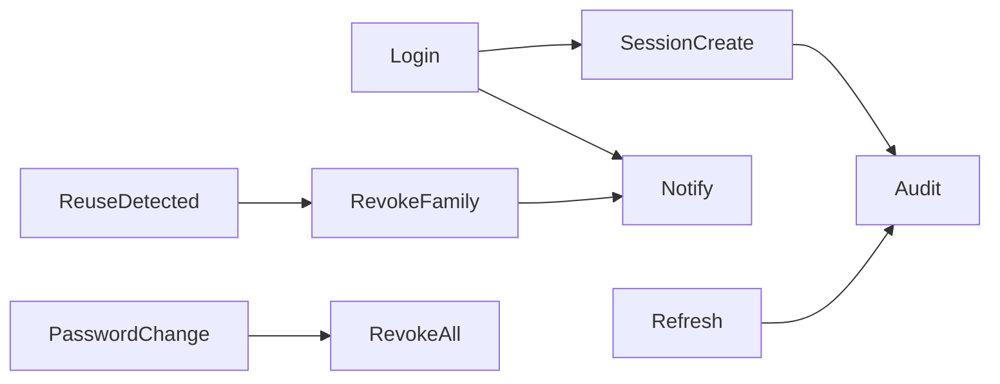

# 08 — Production Authentication Architecture

## 1. Stateful sessions

```text
Browser
  ↓ session cookie
Load balancer
  ↓
API server × N
  ↓
Redis/session store
```

Useful when you need immediate revocation and centralized session control.

## 2. Stateless JWT

```text
Browser
  ↓ JWT
API server × N
  ↓ local verification
```

Useful when many services need to validate identity without a central session lookup.

## 3. Hybrid architecture

A practical high-quality design:

```text
short JWT access token
        +
refresh-token session records
        +
Redis for revocation/rate limiting
        +
MongoDB for durable user/session metadata
```

## 4. Multi-device sessions

```text
userId
 ├── phone session
 ├── laptop session
 └── tablet session
```

The user can revoke one session without logging out everywhere.

## 5. Security event flow



## 6. Rate limiting

Protect:

- login
- register
- password reset
- OTP
- refresh
- OAuth initiation/callback
- sensitive actions

The key is not “block 5 requests per IP forever.” Design limits around the threat model and account/device signals.

## 7. Redis use cases

Redis can support:

```text
session data
rate limits
revocation watermark
temporary OAuth state
OTP attempt counters
distributed locks / single-flight server operations
```

Do not turn Redis into a magical authentication database without deciding which data must be durable.

## 8. Key management

Never hardcode:

```text
JWT_SECRET
Google client secret
refresh encryption key
```

Use environment/secret-management infrastructure.

For asymmetric JWTs, design key rotation:

```text
old public key → still verifies old tokens
new private key → signs new tokens
```

Publish/select keys by key ID (`kid`) when using a JWKS-style architecture.

## 9. Logout all devices

Option A:

```text
revoke all refresh sessions
```

Option B:

```text
validAfter timestamp
```

Option C:

```text
sessionVersion increment
```

Each has different performance and architecture implications.

## 10. Password change

A password change should normally revoke existing refresh-token families/sessions.

Otherwise:

```text
user changes password
attacker's old session remains valid
```

That defeats the user's security action.

## 11. Sensitive actions

Do not rely on a login that happened six hours ago for every action.

Use step-up authentication for:

- payment
- payout
- email change
- password change
- API key creation
- adding a trusted device
- account deletion

## 12. Sessions UI

Useful fields:

```text
Chrome on Windows
last active 2 min ago
Mumbai
[Log out]
```

This gives users a security control that anomaly detection cannot fully replace.

## 13. Notifications

A login alert can reduce detection time:

```text
new session
 ↓
event
 ↓
WebSocket / push / email
 ↓
user sees alert
```

The supplied advanced-auth image models this pattern with a real-time service and other devices.

## 14. Observability

Track:

- login success/failure
- refresh success/failure
- refresh reuse detection
- password reset
- MFA failure
- new device
- logout all
- suspicious geo/device changes

Never put the credential itself in logs.

## 15. Scaling thought process

Ask:

```text
What is on the hot path?
What state must be shared?
What can be verified locally?
What must be revoked immediately?
What happens when Redis is down?
What happens when DB is slow?
What happens when keys rotate?
```

That is a better system-design answer than “use JWT because it scales.”
