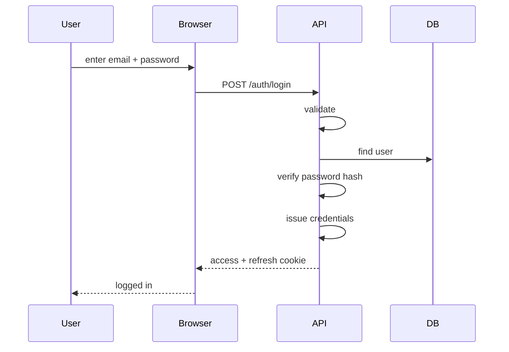
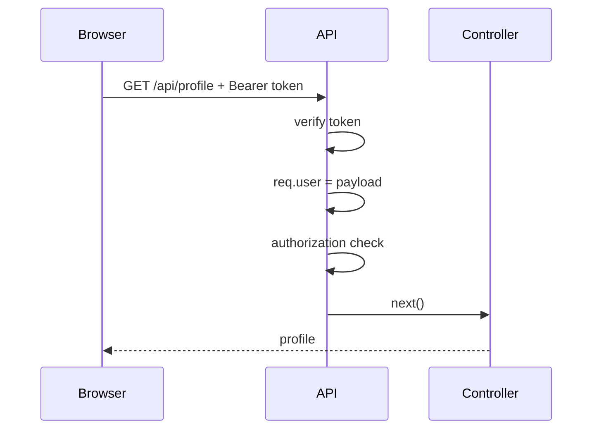
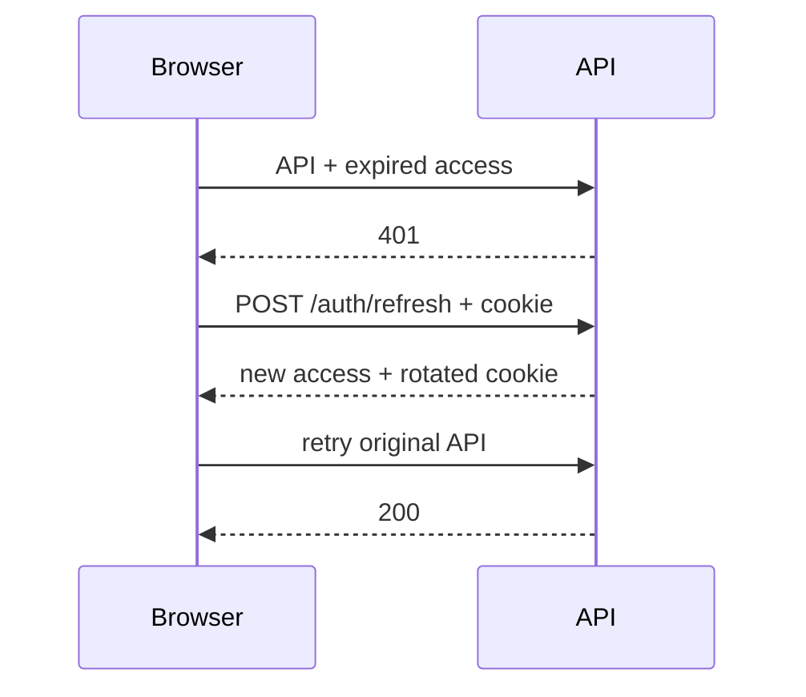
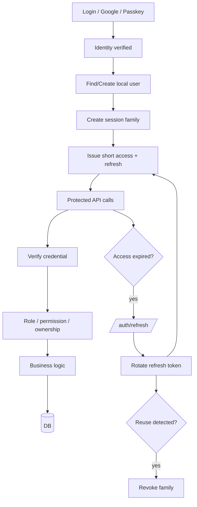

# 11 — Visual Authentication Flows

## 1. Normal password login



## 2. Protected request



## 3. RBAC

```text
DELETE /products/1
       ↓
verify credential
       ↓
req.user.role
       ↓
role == admin ?
   ├─ no → 403
   └─ yes → controller
```

## 4. Access expiry



## 5. Refresh reuse detection

```text
RT1 active
   ↓
refresh
   ↓
RT1 consumed → RT2 active

attacker replays RT1
   ↓
server sees consumed token
   ↓
reuse detected
   ↓
revoke family
```

## 6. Google login

```text
React
 ↓
GET /auth/google
 ↓
Backend
 ↓ 302
Google
 ↓ login + consent
Google
 ↓ 302 code
Backend callback
 ↓ code exchange
Google
 ↓ identity/tokens
Backend
 ↓ find/create local user
Backend
 ↓ app session
React
```

## 7. XSS

```text
unsafe input
 ↓
script execution on origin
 ↓
JS privileges
 ↓
read JS-accessible credential / call API
```

## 8. CSRF

```text
victim logged in
       ↓
attacker website
       ↓
forged request
       ↓
browser auto-attaches cookie
       ↓
server sees authenticated request
```

## 9. Multi-device sessions

```text
                    User
                     │
       ┌─────────────┼─────────────┐
       ▼             ▼             ▼
   iPhone         MacBook        Android
   Session A      Session B      Session C
       │             │             │
       └─────────────┼─────────────┘
                     ▼
                 Session DB
```

## 10. Complete production flow



## 11. Request ownership map

```text
Browser owns:
- UI state
- access token in memory
- refresh cookie storage is browser-managed

Backend owns:
- identity decision
- authorization decision
- token signing keys
- refresh-token session state
- revocation
- audit events
```
